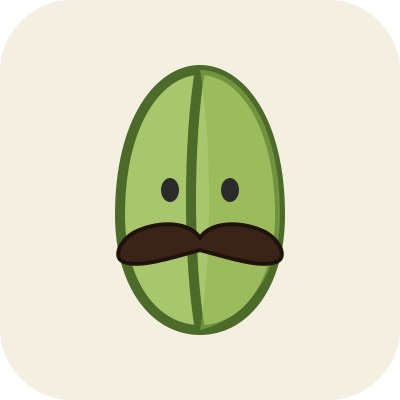

<p align="center">
  
</p>

<h1 align="center">pstache</h1>

<p align="center">Pronounced "pistache". TheHolocoder's AI skills stack, built to evolve.</p>

> Temporary README. Everything here is a work in progress.

## What is this?

pstache is the set of AI skills I use every day on my projects: reusable instructions that guide coding agents through planning, implementing, reviewing and verifying work.

The stack is never finished. Skills are added, reshaped and removed as my workflow changes.

## Inspirations

- [pstack](https://github.com/cursor/plugins/tree/main/pstack) by poteto
- [Skills For Real Engineers](https://github.com/mattpocock/skills) by Matt Pocock

The name is a pun: pstack + moustache, and "pstache" read with the French "p" sounds like *pistache*.

## Layout

```
skills/        active skills, one folder each with a SKILL.md
_incubating/   work in progress, not loaded by any agent
_deprecated/   retired skills, not loaded by any agent
assets/        logo and images
```

## Status

Early draft. No skills are published yet.

## License

[MIT](LICENSE)
